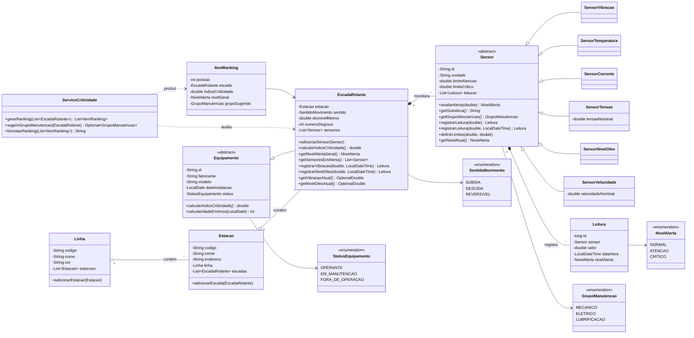

# Escalator Health Monitor

> Manutenção orientada por dados para escadas rolantes de metrô.
> Challenge **Motiva** · FIAP 2026/2027 · Disciplina **Domain Driven Design - Java**


---

## Problema

A Motiva opera linhas de metrô com centenas de escadas rolantes. Quando uma escada quebra, a estação perde
capacidade de fluxo, o passageiro é afetado e o reparo corretivo sai mais caro que a manutenção preventiva.
Cada escada já tem sensores de **vibração**, **temperatura do motor**, **corrente**, **tensão**, **nível de óleo
do redutor** e **velocidade dos degraus**, mas leituras soltas não dizem à equipe de manutenção **qual escada
atender primeiro**.

## Solução

O sistema modela o domínio em Java orientado a objetos e transforma as leituras em decisões:

1. **Cada sensor classifica a própria leitura** em `NORMAL`, `ATENCAO` ou `CRITICO`, com uma regra por grandeza:
   óleo é ruim quando baixo, temperatura quando alta, tensão quando sai da faixa para cima ou para baixo, e
   assim por diante. Os limites vêm de normas técnicas ou de premissas documentadas.
2. **Cada escada calcula o próprio índice de criticidade**, somando os pesos dos níveis atuais dos sensores
   (Normal 0, Atenção 3, Crítico 10). Os pesos não são lineares de propósito: um sensor crítico pesa mais que
   três sensores em atenção.
3. **O `ServicoCriticidade` gera o ranking** da escada mais crítica para a menos crítica e **sugere o grupo de
   manutenção** (Mecânico, Elétrico ou Lubrificação) pelo grupo com maior soma de pesos em alerta.

## Tecnologias

- **Java 17+** puro (compila com `--release 17`; executado e testado no JDK 26)
- Sem frameworks, sem bibliotecas externas, sem Maven/Gradle
- Javadoc validado com `-Xdoclint:all`
- Modelo relacional pensado para **Oracle** (Oracle Data Modeler)

---

## Diagrama de classes



## Estrutura de pacotes

```
src/
└── br/com/fiap/motiva/
    ├── Main.java                     # demonstração: cria objetos, chama serviços, imprime
    ├── enums/
    │   ├── NivelAlerta.java          # NORMAL, ATENCAO, CRITICO (com peso)
    │   ├── GrupoManutencao.java      # MECANICO, ELETRICO, LUBRIFICACAO
    │   ├── SentidoMovimento.java     # SUBIDA, DESCIDA, REVERSIVEL
    │   └── StatusEquipamento.java    # OPERANTE, EM_MANUTENCAO, FORA_DE_OPERACAO
    ├── model/
    │   ├── Linha.java                # linha do metrô (contém estações)
    │   ├── Estacao.java              # localização (contém escadas)
    │   ├── Equipamento.java          # abstrata
    │   ├── EscadaRolante.java        # objeto central do domínio
    │   ├── Leitura.java              # medição imutável já classificada
    │   └── sensor/
    │       ├── Sensor.java           # abstrata
    │       ├── SensorVibracao.java
    │       ├── SensorTemperatura.java
    │       ├── SensorCorrente.java
    │       ├── SensorTensao.java
    │       ├── SensorNivelOleo.java
    │       └── SensorVelocidade.java
    └── service/
        ├── ServicoCriticidade.java   # ranking + grupo de manutenção sugerido
        └── ItemRanking.java          # uma posição do ranking
```

## Limites de alerta e origem

| Sensor | Unidade | Regra | Atenção | Crítico | Origem |
|---|---|---|---|---|---|
| Vibração | mm/s RMS | alto é ruim | ≥ 2,8 | ≥ 4,5 | ISO 10816-3 / 20816-3, grupo 2, base rígida (zonas B/C e C/D) |
| Temperatura do motor | °C | alto é ruim | ≥ 80 | ≥ 100 | Premissa: carcaça de motor com isolamento classe F (IEC 60034-1 / NBR 17094) |
| Corrente | A | alto é ruim | ≥ 105% de I<sub>n</sub> | ≥ 115% de I<sub>n</sub> | Fator de serviço 1,15 (IEC/NBR 17094); I<sub>n</sub> padrão 29 A (motor de 15 kW em 380 V) |
| Tensão | V | fora da faixa é ruim | desvio ≥ 5% | desvio ≥ 10% | IEC 60034-1, zonas A (±5%) e B (±10%); nominal 380 V |
| Nível de óleo | % | baixo é ruim | ≤ 60 | ≤ 40 | Premissa: marcas de mínimo e máximo do visor do redutor |
| Velocidade | m/s | fora da faixa é ruim | desvio ≥ 5% | desvio ≥ 15% | NBR NM 195 / EN 115-1 (nominal 0,5 m/s, máx. 0,75 m/s, monitoramento de 15%) |

O Javadoc de cada sensor detalha a origem dos limites, e cada sensor aceita limites personalizados por
construtor sobrecarregado.

---

## Como rodar

Pré-requisito: **JDK 17 ou superior** no `PATH` (`java -version`).

### Terminal

```bash
# compilar
javac -encoding UTF-8 -d out $(find src -name "*.java")

# executar
java -cp out br.com.fiap.motiva.Main

# gerar o Javadoc (abre em doc/index.html)
javadoc -encoding UTF-8 -d doc -Xdoclint:all -sourcepath src -subpackages br.com.fiap.motiva
```

> O `-encoding UTF-8` só é necessário no JDK 17 em Windows, que não usa UTF-8 como padrão. A partir do
> JDK 18 o UTF-8 já é o padrão. No Windows, rode `chcp 65001` antes para o console exibir os acentos.

### IntelliJ IDEA

1. **File › Open** e selecione a pasta do projeto.
2. Confira se `src` está marcada como **Sources Root** (ícone azul; se não estiver: botão direito em
   `src` › **Mark Directory as › Sources Root**).
3. Em **File › Project Structure › Project**, selecione um SDK 17 ou superior.
4. Abra `br.com.fiap.motiva.Main` e clique em **Run** (▶).

### Eclipse

1. **File › New › Java Project**, desmarque *Use default location* e aponte para a pasta do projeto.
2. Garanta que `src` está no **Build Path** como pasta de código-fonte e que o JRE é 17 ou superior.
3. Botão direito em `Main.java` › **Run As › Java Application**.

---

## Exemplo de saída: ranking de criticidade

```
+-----+---------------+-------------+--------+----------+-------+-------+----------------+
| #   | Escada        | Estação     | Índice | Nível    | Crít. | Aten. | Grupo sugerido |
+-----+---------------+-------------+--------+----------+-------+-------+----------------+
| 1º  | ESC-L5-SAM-01 | Santo Amaro |     36 | Crítico  |     3 |     2 | Elétrica       |
| 2º  | ESC-L5-LTR-01 | Largo Treze |     13 | Crítico  |     1 |     1 | Lubrificação   |
| 3º  | ESC-L4-FLI-02 | Faria Lima  |      9 | Atenção  |     0 |     3 | Mecânica       |
| 4º  | ESC-L4-LUZ-01 | Luz         |      6 | Atenção  |     0 |     2 | Elétrica       |
| 5º  | ESC-L4-PAU-01 | Paulista    |      0 | Normal   |     0 |     0 | -              |
+-----+---------------+-------------+--------+----------+-------+-------+----------------+
Sensores em alerta:
  1º  ESC-L5-SAM-01: Vibração 4.9 mm/s (Crítico), Temperatura do motor 103.0 °C (Crítico), Corrente 34.1 A (Crítico), Tensão 349.0 V (Atenção), Velocidade dos degraus 0.46 m/s (Atenção)
  2º  ESC-L5-LTR-01: Nível de óleo 36.0 % (Crítico), Vibração 3.0 mm/s (Atenção)
  3º  ESC-L4-FLI-02: Vibração 3.2 mm/s (Atenção), Nível de óleo 57.0 % (Atenção), Velocidade dos degraus 0.47 m/s (Atenção)
  4º  ESC-L4-LUZ-01: Corrente 30.9 A (Atenção), Tensão 402.0 V (Atenção)
  5º  ESC-L4-PAU-01: nenhum
Índice = soma dos pesos do nível atual de cada sensor (Normal 0, Atenção 3, Crítico 10)
```

Leitura do resultado: a escada de Santo Amaro tem motor superaquecido, em sobrecarga e com vibração em zona D,
por isso vai para a equipe **elétrica** primeiro. A de Largo Treze tem só um alerta crítico, mas é de óleo, e
vai para a **lubrificação** antes que o redutor seja danificado.

A `Main` também imprime todos os objetos (`toString()` sobrescrito), o histórico de leituras, a demonstração
de polimorfismo, os métodos sobrecarregados e as validações. Os dados de estações, fabricantes e leituras são
**ilustrativos**.

---

## Onde estão os 4 pilares de POO

| Pilar | Onde aparece |
|---|---|
| **Abstração** | [`Equipamento`](src/br/com/fiap/motiva/model/Equipamento.java) é abstrata, com `calcularIndiceCriticidade()` abstrato. [`Sensor`](src/br/com/fiap/motiva/model/sensor/Sensor.java) é abstrata, com `avaliarAlerta(double)`, `getGrandeza()` e `getGrupoManutencao()` abstratos. |
| **Encapsulamento** | Todos os atributos são `private`. Os setters validam e lançam `IllegalArgumentException`: `setNumeroDegraus`, `setDesnivelMetros`, `setDataInstalacao` e `definirLimites`. Leitura de óleo fora de 0 a 100% é rejeitada em [`SensorNivelOleo.validarValor`](src/br/com/fiap/motiva/model/sensor/SensorNivelOleo.java). As listas são expostas só como `unmodifiableList`, e [`Leitura`](src/br/com/fiap/motiva/model/Leitura.java) é imutável, com o nível calculado pelo próprio sensor. |
| **Herança** | `EscadaRolante extends Equipamento`. `SensorVibracao`, `SensorTemperatura`, `SensorCorrente`, `SensorTensao`, `SensorNivelOleo` e `SensorVelocidade` estendem `Sensor`. |
| **Polimorfismo** | *Sobrescrita:* `avaliarAlerta(double)` em cada sensor, com 3 regras diferentes (alto, baixo, faixa), além de `validarValor`, `validarLimites`, `descreverLimites` e `toString`. A `Main` percorre uma `List<Sensor>` chamando `avaliarAlerta(50.0)`, e o mesmo valor dá resultados diferentes. *Sobrecarga:* `registrarLeitura(double)` e `registrarLeitura(double, LocalDateTime)`; construtores de `SensorCorrente(id)`, `(id, nominal)` e `(id, atenção, crítico)`; `SensorTensao` com 3 construtores; `EscadaRolante` e `Equipamento` com e sem `status`; `Leitura` com e sem `id`. |

---

## Mapeamento classe -> tabela

Prefixo `T_MTV_` (Motiva). Modelo relacional para o Oracle Data Modeler, com **6 entidades**.

| Classe Java | Tabela | PK | FKs | Colunas principais |
|---|---|---|---|---|
| `Linha` | `T_MTV_LINHA` | `CD_LINHA` | | `NM_LINHA`, `DS_COR` |
| `Estacao` | `T_MTV_ESTACAO` | `CD_ESTACAO` | `CD_LINHA` → `T_MTV_LINHA` | `NM_ESTACAO`, `DS_ENDERECO` |
| `Equipamento` | `T_MTV_EQUIPAMENTO` | `ID_EQUIPAMENTO` | | `NM_FABRICANTE`, `NM_MODELO`, `DT_INSTALACAO`, `ST_EQUIPAMENTO`, `TP_EQUIPAMENTO` |
| `EscadaRolante` | `T_MTV_ESCADA_ROLANTE` | `ID_EQUIPAMENTO` (PK e FK) | `ID_EQUIPAMENTO` → `T_MTV_EQUIPAMENTO`; `CD_ESTACAO` → `T_MTV_ESTACAO` | `TP_SENTIDO`, `NR_DESNIVEL`, `QT_DEGRAUS` |
| `Sensor` e as 6 subclasses | `T_MTV_SENSOR` | `ID_SENSOR` | `ID_EQUIPAMENTO` → `T_MTV_ESCADA_ROLANTE` | `TP_SENSOR`, `DS_UNIDADE`, `VL_LIMITE_ATENCAO`, `VL_LIMITE_CRITICO`, `VL_NOMINAL` |
| `Leitura` | `T_MTV_LEITURA` | `ID_LEITURA` | `ID_SENSOR` → `T_MTV_SENSOR` | `VL_LEITURA`, `DT_LEITURA`, `NV_ALERTA` |
| `ServicoCriticidade`, `ItemRanking` | sem tabela | | | Calculados em memória a cada execução |
| Enums | sem tabela | | | Viram colunas com `CHECK` (ver abaixo) |

### Decisões e justificativas

- **Herança de `Sensor`: tabela única `T_MTV_SENSOR` com a coluna discriminadora `TP_SENSOR`**
  (`CHECK (TP_SENSOR IN ('VIBRACAO','TEMPERATURA','CORRENTE','TENSAO','NIVEL_OLEO','VELOCIDADE'))`).
  As 6 subclasses diferem na *regra* (`avaliarAlerta`), que é comportamento e não dado. Os dados são os
  mesmos: unidade e dois limites. A única coluna específica é `VL_NOMINAL`, preenchida só para `TENSAO` e
  `VELOCIDADE`. Seis tabelas quase idênticas só complicariam os JOINs.
- **Herança de `Equipamento`: uma tabela por classe** (`T_MTV_EQUIPAMENTO` + `T_MTV_ESCADA_ROLANTE`, ligadas
  1:1 pela mesma PK). Aqui a escolha é diferente da de `Sensor` de propósito: `Equipamento` é um supertipo
  pensado para crescer (elevadores, bombas, catracas), e cada subtipo terá colunas próprias. Os dados comuns
  ficam em um único lugar e `TP_EQUIPAMENTO` identifica o subtipo.
- **Sentido da associação Escada-Sensor:** em Java a escada conhece os sensores (`List<Sensor>`) e o sensor
  não aponta de volta para a escada, o que evita ciclos e mantém o sensor reutilizável. No banco, a FK
  `ID_EQUIPAMENTO` fica em `T_MTV_SENSOR`, como é o padrão do 1:N. A regra Java "um sensor por grandeza"
  vira `UNIQUE (ID_EQUIPAMENTO, TP_SENSOR)`.
- **`NV_ALERTA` é persistido em `T_MTV_LEITURA`**, mesmo podendo ser recalculado. Os limites podem mudar
  com o tempo, e o histórico precisa guardar como a leitura foi classificada no momento da medição.
- **Enums como `CHECK`:** `NivelAlerta`, `SentidoMovimento` e `StatusEquipamento` são domínios pequenos e
  estáveis, por isso viram `VARCHAR2` com `CHECK`. `GrupoManutencao` não é persistido, porque é derivado do
  `TP_SENSOR`. Se a avaliação exigir mais entidades, os enums podem virar tabelas de domínio
  (ex.: `T_MTV_NIVEL_ALERTA`) sem mudar o código Java.
- **Limites derivados:** em Java, `SensorCorrente(id, correnteNominal)` calcula os limites (105% e 115%).
  No banco ficam só os limites já calculados em `VL_LIMITE_ATENCAO` e `VL_LIMITE_CRITICO`, que é o que a
  regra usa.
- **Chaves:** `Linha`, `Estacao`, `Equipamento` e `Sensor` usam códigos de negócio como PK (`L4`, `PAU`,
  `ESC-L4-PAU-01`), espelhando os identificadores do código Java. `Leitura` usa PK numérica gerada por
  `IDENTITY` ou sequence, por ser uma tabela de alto volume.

---

## Integrantes

| Nome | RM | GitHub |
|---|---|---|
| Nome do Integrante | RM00000 | [@usuario](https://github.com/usuario) |
| Nome do Integrante | RM00000 | [@usuario](https://github.com/usuario) |
| Nome do Integrante | RM00000 | [@usuario](https://github.com/usuario) |
| Nome do Integrante | RM00000 | [@usuario](https://github.com/usuario) |
| Nome do Integrante | RM00000 | [@usuario](https://github.com/usuario) |
